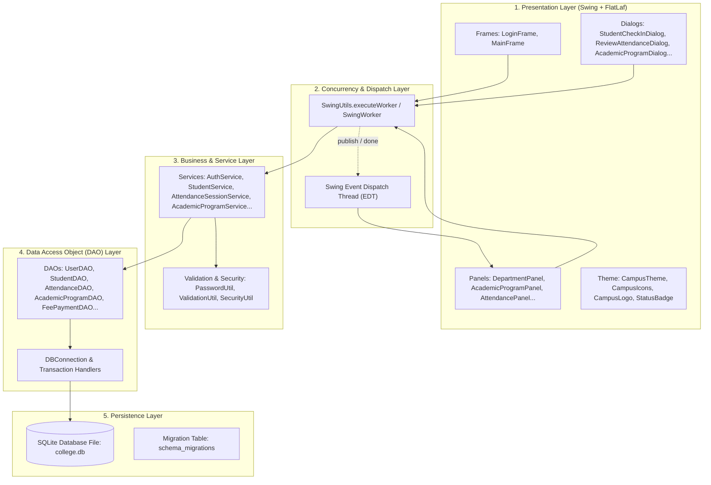
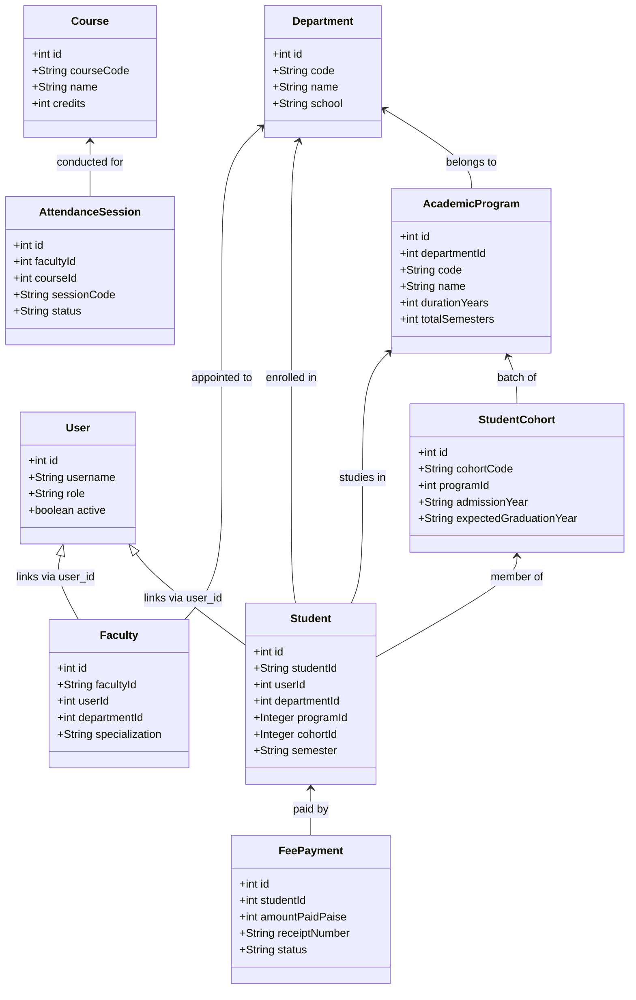
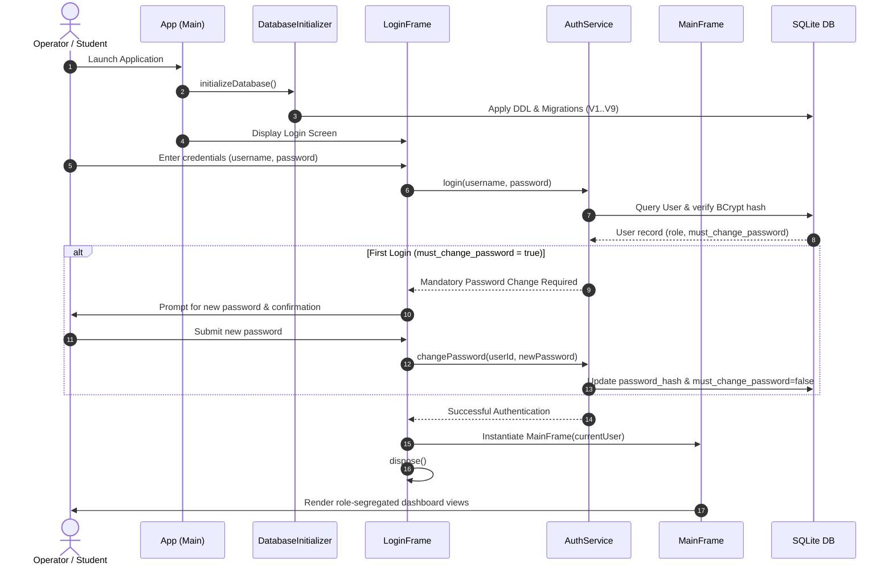

# CAMPUS ERP — ARCHITECTURE MANUAL
**System:** Campus ERP — College Management System  
**Version:** 2.3.0  
**Target Platform:** Java SE 17+ | Java Swing + FlatLaf | Pure SQLite JDBC  
**Architecture Pattern:** Layered Desktop Architecture (`Model → DAO → Service → SwingWorker → Swing UI`)  

---

## 1. Architectural Principles

Campus ERP is built upon an offline-first, layered desktop architecture engineered for institutional stability, predictability, and responsive user feedback:
- **Separation of Concerns:** Business logic is isolated from UI presentation and database persistence.
- **Pure Java SE & Standard Libraries:** Eliminates external application servers, web containers, or distributed runtime infrastructure.
- **Thread Safety on Swing EDT:** All long-running database, credential hashing, and analytical calculations run on background threads via `SwingWorker` or `SwingUtils.executeWorker`, keeping the Swing Event Dispatch Thread (EDT) completely responsive.
- **Idempotent Data Access:** Stateless DAO layers communicating via parameterized JDBC statements to prevent SQL injection and connection leaks.
- **Deterministic Schema Evolution:** Additive, forward-only migrations managed inside `DatabaseInitializer.java` guarantee backward compatibility with legacy databases.

---

## 2. Layer Responsibilities

### 2.1 Layer Breakdown

1. **Presentation Layer (`com.college.ui.*`):**
   - Implements modern, accessible desktop interfaces utilizing FlatLaf styling (`#1E3A5F` primary navy, `#C97A63` warm terracotta, `#F5F6F2` canvas).
   - Uses `CardLayout` in `MainFrame.java` to switch between views instantaneously without spawning secondary application windows.
   - Vector-rendered iconography in `CampusIcons.java` eliminates missing-glyph unicode errors across different operating systems.

2. **Concurrency & Dispatch Layer (`com.college.ui.util.SwingUtils`):**
   - Encapsulates `javax.swing.SwingWorker` to offload database calls, password hashing, and report exports to background worker threads.
   - Dispatches safe UI callbacks back onto the EDT to prevent GUI deadlocks.

3. **Service Layer (`com.college.service.*`):**
   - Implements business logic, transaction boundaries, domain invariant checks, and Role-Based Access Control (RBAC).
   - Validates user input through `ValidationUtil` and manages BCrypt password hashing through `PasswordUtil`.

4. **Data Access Object (DAO) Layer (`com.college.dao.*`):**
   - Encapsulates pure SQL operations using JDBC `PreparedStatement` and `ResultSet`.
   - Handles connection retrieval from `DBConnection.getConnection()`, transaction management (`conn.setAutoCommit(false)`), and explicit rollback upon exceptions.

5. **Persistence Layer (`com.college.config.*`):**
   - Manages SQLite connection pools and database initialization via `DatabaseInitializer.java`.
   - Executes DDL (`schema.sql`), seed data (`seed.sql`), and additive versioned migrations (`V1` through `V9`).

---

## 3. Module Relationships

---

## 4. Application Execution Flow

