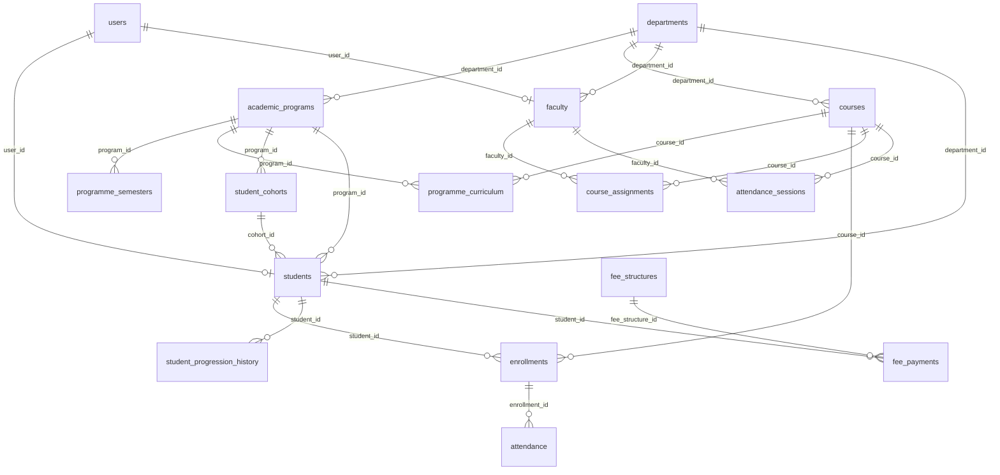
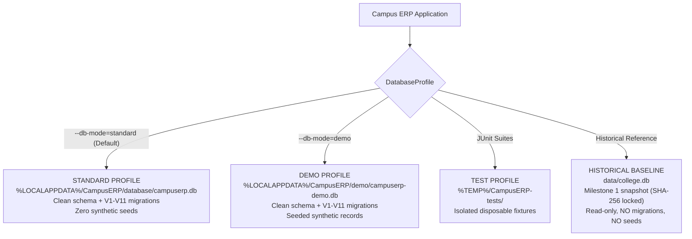

# CAMPUS ERP — DATABASE DESIGN MANUAL
**Engine:** SQLite 3.54+ (Pure JDBC, Embedded)  
**Target Release:** Campus ERP v2.3.0  
**Schema Version:** V11 (18 Relational Tables, 50+ Indices, 8 Triggers, and Foreign Keys)  
**Production Integrity:** `data/college.db` (SHA-256: `27f160e79fe67f0054503f42ceeea79c2d0e929a030f3b5463f00c6ddf0b8346`)  

---

## 1. Database Overview & Design Philosophy

Campus ERP employs SQLite as an embedded, zero-configuration, ACID-compliant relational data store.
Key architectural design choices:
- **Foreign Key Constraints Enabled:** `PRAGMA foreign_keys = ON;` is enforced on every JDBC connection to maintain strict referential integrity.
- **Normalized Data Model:** Relational normalization across user credentials, departments, degree programmes, curriculum mappings, cohorts, attendance, and finances.
- **Monetary Storage in Paise:** All financial amounts are stored as 64-bit integers in paise (`amount_paise`), eliminating IEEE-754 floating-point rounding errors.
- **Audit Trails:** Immutable history tables (`audit_log`, `student_progression_history`) record who performed changes, previous values, new values, and timestamps.

---

## 2. Entity-Relationship (ER) Architecture

---

## 3. Core Relational Entities & Schema Definitions

### 3.1 User & Identity Tables
- **`users`**: Base authentication table storing `username` (UNIQUE), `password_hash` (BCrypt), `role` (`ADMIN`, `FACULTY`, `STUDENT`), `must_change_password` (0/1), and `active` (0/1).
- **`students`**: Enrolled students table linking `user_id` (FK to `users`), `student_id` (UNIQUE institutional registration code), `department_id`, `program_id`, `cohort_id`, `semester`, `admission_year`, `expected_graduation_year`, and personal contact details.
- **`faculty`**: Faculty personnel table linking `user_id` (FK to `users`), `faculty_id` (UNIQUE employee code), `department_id`, `specialization`, and hire details.

### 3.2 Academic Hierarchy Tables
- **`departments`**: Academic units with `code` (UNIQUE), `name`, `school` (Faculty grouping), `head_of_department`, `contact_email`, `contact_phone`, and `active` flag.
- **`academic_programs`**: Degree programmes with `department_id`, `code` (UNIQUE), `name`, `degree_level` (`UNDERGRADUATE`, `POSTGRADUATE`, `RESEARCH`, `DIPLOMA`), `duration_years`, `total_semesters`, `credits_required`, and `academic_regulation`.
- **`programme_semesters`**: Term breakdowns with `program_id`, `semester_number`, `semester_label`, `term_type` (`SEMESTER`, `COURSEWORK`, `RESEARCH_TERM`, `THESIS`), and `credits_target`.
- **`programme_curriculum`**: Syllabus curriculum mappings with `program_id`, `semester_number`, `course_id`, `course_category` (`CORE`, `ELECTIVE`, `LABORATORY`, `PROJECT`, `RESEARCH`), `is_mandatory`, `prerequisite_course_id`, and `academic_regulation`.
- **`student_cohorts`**: Admission batches with `cohort_code` (UNIQUE, e.g. `BTECH-AI-2026`), `program_id`, `admission_year`, `expected_graduation_year`, `current_semester`, and `status`.
- **`student_progression_history`**: Immutable progression logs recording `student_id`, `previous_semester`, `new_semester`, `academic_year`, `action` (`PROMOTED`, `HELD`, `REPEATED`), `performed_by` (FK to `users`), and `reason`.

### 3.3 Course, Scheduling & Attendance Tables
- **`courses`**: Course catalog storing `course_code` (UNIQUE), `name`, `department_id`, `credits`, `semester`, `max_capacity`, and `active`.
- **`course_assignments`**: Faculty teaching allocations per semester and academic year.
- **`enrollments`**: Student course registrations with `student_id`, `course_id`, `academic_year`, `enrolled_date`, and `status`.
- **`timetables`**: Weekly schedule matrix with `course_id`, `faculty_id`, `department_id`, `semester`, `day_of_week`, `start_time`, `end_time`, `classroom`, and `academic_year`.
- **`attendance_sessions`**: Timed check-in sessions with `course_id`, `faculty_id`, `session_date`, `session_code` (6-digit numeric OTP), `expires_at`, `status` (`OPEN`, `CLOSED`, `FINALIZED`), and `session_number`.
- **`attendance`**: Daily attendance records with `enrollment_id`, `attendance_date`, `status` (`PRESENT`, `ABSENT`, `LATE`, `EXCUSED`), and `session_code`.
- **`attendance_failed_attempts`**: Anti-tampering tracking recording failed check-in attempts per student session.

### 3.4 Finance Tables
- **`fee_structures`**: Defined tuition schedules with `department_id`, `semester`, `fee_type`, `amount_paise`, `academic_year`, and `due_date`.
- **`fee_payments`**: Collections with `student_id`, `fee_structure_id`, `amount_paid_paise`, `payment_method`, `receipt_number` (UNIQUE), `gateway_order_id`, `gateway_payment_id`, `utr_number`, and `verification_status`.
- **`institution_bank_details`**: College bank accounts with `account_name`, `account_number`, `ifsc_code`, `bank_name`, and `branch`.

---

## 4. Database Migration Approach

The system employs a deterministic, forward-only additive migration pipeline in `DatabaseInitializer.java`. When the application initializes:
1. `PRAGMA foreign_keys = ON;` is executed.
2. The core DDL in `/schema.sql` creates any missing baseline tables (`CREATE TABLE IF NOT EXISTS`).
3. Core demo seed data in `/seed.sql` is conditionally populated (`INSERT OR IGNORE`).
4. The migration table `schema_migrations` tracks all incremental versions:

| Version | Description | Key Changes |
|:---|:---|:---|
| `V1__base_schema` | Initial core schema | 13 core tables (users, students, faculty, departments, courses, enrollments, attendance, fees). |
| `V2__attendance_session_code` | Attendance OTP support | Added `session_code` column and index to `attendance`. |
| `V3__timetables` | Timetable scheduling | Created `timetables` table with classroom, day, and time slots. |
| `V4__user_management_columns` | Security hardening | Added `must_change_password` and `active` flags to `users`. |
| `V5__fee_payment_refunds` | Dual-entry accounting | Added `original_payment_id` column to support credit refund records. |
| `V6__attendance_sessions` | Timed check-in sessions | Created `attendance_sessions` table with OTP expiry. |
| `V7__bank_details_and_online_payments` | Online payments & bank transfers | Created `institution_bank_details` and extended `fee_payments` with UTR/gateway audit columns. |
| `V8__attendance_automation_enhancements` | Audit & tamper lockout | Added `session_number`, `finalized_by`, and created `attendance_failed_attempts`. |
| `V9__academic_structure_and_programmes` | Academic hierarchy & progression | Added `school` to `departments`, created `academic_programs`, `programme_semesters`, `programme_curriculum`, `student_cohorts`, and `student_progression_history`. |
| `V10__milestone4_stabilization` | Progression immutability & cohort consistency | Added progression deletion/update prevention triggers (`trg_prevent_progression_history_del`, `trg_prevent_progression_history_upd`), cohort-programme alignment triggers (`trg_student_cohort_prog_ins`, `trg_student_cohort_prog_upd`), and historical department school normalization. |
| `V11__progression_history_fk_rebuild` | Foreign key RESTRICT enforcement | Rebuilt `student_progression_history` table for legacy V9 databases to safely transition foreign key from `ON DELETE CASCADE` to `ON DELETE RESTRICT`. |

### 4.1 Database Engine Triggers (8 Active Triggers)
1. **`trg_audit_log_no_update`**: Prohibits any `UPDATE` on `audit_log`.
2. **`trg_audit_log_no_delete`**: Prohibits any `DELETE` on `audit_log`.
3. **`trg_fee_payments_refund_integrity`**: Validates refund referential integrity on `INSERT`.
4. **`trg_fee_payments_immutable_update`**: Enforces strict ledger immutability and valid status transitions on `UPDATE`.
5. **`trg_prevent_progression_history_del`**: Prohibits any `DELETE` on `student_progression_history`.
6. **`trg_prevent_progression_history_upd`**: Prohibits any `UPDATE` on `student_progression_history`.
7. **`trg_student_cohort_prog_ins`**: Rejects `INSERT` into `students` if `cohort_id` does not belong to `program_id`.
8. **`trg_student_cohort_prog_upd`**: Rejects `UPDATE` on `students` if `cohort_id` does not belong to `program_id`.

### Idempotency Guarantee
All schema alterations check for column existence via `PRAGMA table_info` before executing `ALTER TABLE ADD COLUMN`. Duplicate executions produce zero errors, zero duplicate columns, and zero data loss.

---

## 5. Database Separation Architecture (Milestone 0.3)

Campus ERP strictly separates database environments into four isolated profiles:

### 5.1 Profile Specification

| Profile | Storage Location | Synthetic Data (`seed.sql`) | Forward Migrations (V1–V11) | Security / Write Policy |
| :--- | :--- | :--- | :--- | :--- |
| **`STANDARD`** | `%LOCALAPPDATA%\CampusERP\database\campuserp.db` | **Prohibited** (0 seed records) | Automatically applied | Standard institutional profile. Admin account provisioned via wizard/CLI. |
| **`DEMO`** | `%LOCALAPPDATA%\CampusERP\demo\campuserp-demo.db` | **Populated** (Users, Depts, Courses) | Automatically applied | Interactive demonstrations & testing. Isolated from production records. |
| **`TEST`** | `%TEMP%\CampusERP-tests\` | Isolated per suite | Automatically applied | Temporary databases generated during Maven test runs and cleaned up upon exit. |
| **`HISTORICAL`** | `data/college.db` | **Read-Only** | **Prohibited** | SHA-256 `27F160E79FE67F0054503F42CEEEA79C2D0E929A030F3B5463F00C6DDF0B8346`. Read-only milestone baseline. |

