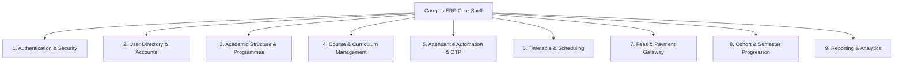

# CAMPUS ERP — PROJECT OVERVIEW
**System Title:** Campus ERP — College Management System  
**Version:** 2.3.0  
**Technology:** Java 17, Java Swing, SQLite 3.54, FlatLaf  
**Architecture:** Offline Desktop Application (Model → DAO → Service → SwingWorker → Swing UI)  

---

## 1. Problem Statement

Collegiate educational institutions often struggle with fragmented, brittle administrative record-keeping systems. Student directories, academic course registrations, faculty teaching assignments, daily attendance tracking, fee collections, and semester progress reports are frequently scattered across disconnected spreadsheets or poorly secured localized tools.

This fragmentation leads to:
- High operational overhead and duplicate data entry.
- Risk of credential leakages and poor access control.
- Inaccurate attendance calculations resulting in graduation disputes.
- Inability to track structured degree progressions across multi-year cohorts.
- Lack of auditability for financial transactions and administrative decisions.

---

## 2. Project Objectives

Campus ERP is designed to provide a unified, secure, and reliable institutional management desktop platform tailored for collegiate operations:
1. **Unified Relational Core:** Centralize student, faculty, department, course, attendance, timetable, fee, and progression records within an ACID-compliant embedded SQLite relational database.
2. **Strict Security & RBAC:** Enforce comprehensive Role-Based Access Control (`ADMIN`, `FACULTY`, `STUDENT`) backed by BCrypt password hashing, session auditing, and first-login password expiration.
3. **Automated Academic Workflows:** Automate repetitive academic processes including student admission account generation, timed attendance OTP sessions, curriculum prerequisite validation, and batch semester progression.
4. **Resilient Offline Architecture:** Provide instant desktop responsiveness using Java Swing and FlatLaf without external server dependencies, network latency, or distributed backend complexity.
5. **Auditable Administrative Actions:** Maintain immutable audit logs for user logins, security state transitions, fee receipts, and semester progression decisions.

---

## 3. System Scope

### Included in Scope:
- **Offline Single-Node Deployment:** Fully functional embedded desktop application running on Java 17+.
- **User & Credential Management:** Role-segregated logins, automated username generation, temporary passwords, and secure password reset.
- **Academic Hierarchy Management:** Schools, Departments, Academic Programmes (`UNDERGRADUATE`, `POSTGRADUATE`, `RESEARCH`, `DIPLOMA`), Curriculum mappings, and Admission Cohorts.
- **Course Administration & Enrollment:** Course catalogs, credit definitions, capacity quotas, and prerequisite validation.
- **Attendance Automation:** Timed OTP sessions, student self-service check-in, faculty live rosters, and low-attendance tracking.
- **Timetable Management:** Weekly scheduling matrix for departments, courses, faculty, and classrooms.
- **Fee Collection & Receipts:** Semester fee schedules, payment recording with automatic sequential receipt numbers, simulated online gateway flows, and dual-entry refund logging.
- **Academic Progression:** Semester promotion, hold, and repeat pipelines with mandatory justification logs.
- **Analytical Reporting:** Multi-module tabular reports and CSV data export capabilities.

### Deferred / Future Scope (Semester Break):
- Multi-device networked concurrency (Client-Server / REST API).
- Mobile and browser-based interfaces.
- Real-time third-party biometric scanner hardware integration.

---

## 4. Main Modules

1. **Authentication & Session Management (`AuthService`, `LoginFrame`):** Authenticates users via BCrypt verification, initializes session state, logs access events, and routes to role-specific views.
2. **User Management (`UserManagementPanel`, `StudentService`, `FacultyService`):** Manages user accounts, active status toggling, and automated credential provisioning.
3. **Academic Structure & Programmes (`DepartmentPanel`, `AcademicProgramPanel`):** Organizes schools, departments, degree levels, durations, and credit targets.
4. **Curriculum & Enrollment (`ProgrammeCurriculumPanel`, `EnrollmentPanel`):** Maps syllabus courses to semesters and registers students to approved course sections.
5. **Attendance Automation (`AttendancePanel`, `StudentCheckInDialog`):** Generates timed 6-digit OTP codes for quick student check-in and provides faculty with live review grids.
6. **Timetable Scheduling (`TimetablePanel`):** Allocates lecture slots across classrooms and prevents faculty scheduling overlaps.
7. **Fee Management & Payments (`FeeStructurePanel`, `FeePaymentPanel`):** Tracks tuition dues, payment methods, bank UTR references, receipts, and simulated gateway callbacks.
8. **Cohort Progression (`CohortProgressionPanel`):** Manages batch admissions and handles semester advancement with comprehensive audit history.
9. **Reporting & Analytics (`ReportPanel`, `AcademicOverviewPanel`):** Displays aggregated executive KPI cards and exports roster spreadsheets.

---

## 5. Target Users

| User Persona | Role Identifier | Primary Responsibilities & Permitted Actions |
|:---|:---|:---|
| **System Administrator / Registrar** | `ADMIN` | Complete institutional oversight: manages users, departments, programmes, courses, cohorts, progressions, and financial structures. |
| **Faculty Member / Department Chair** | `FACULTY` | Manages assigned courses, creates timed attendance sessions, reviews check-ins, inputs student examination marks, and views teaching timetables. |
| **Enrolled Student** | `STUDENT` | Views personalized timetable, checks in to active attendance sessions via OTP, registers for courses, reviews academic marks, and inspects fee payment receipts. |

