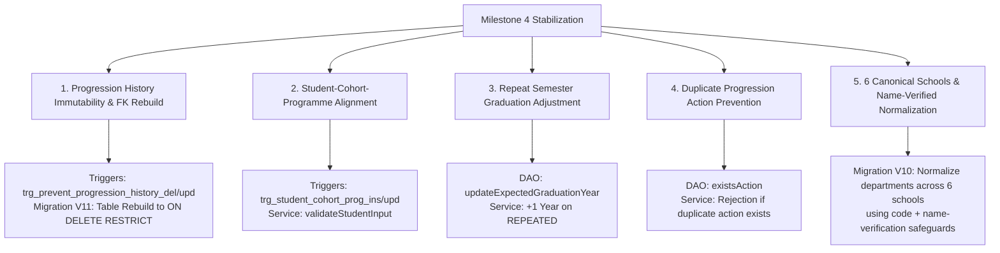

# CAMPUS ERP — MILESTONE 4 STABILIZATION & REPOSITORY FINALIZATION REPORT

**Project:** Campus ERP — College Management System  
**Baseline Release:** v2.1.0 Checkpoint / Milestone 4  
**Target Release:** Campus ERP v2.3.0  
**Authors:** Senior Java Software Architect, SQLite Database Architect, Software Quality Lead, Repository Maintainer  
**Date of Audit:** November 11, 2026  
**Final Acceptance Verdict:** **PASS WITH LIMITATIONS (PENDING PHYSICAL DESKTOP ACCEPTANCE)**  

---

## 1. Executive Summary & Verification Objective

This document presents the definitive technical stabilization, quality assurance audit, security hardening, and repository finalization report for **Campus ERP — College Management System**. 

Following the implementation of Milestone 4 (Institutional Academic Structure, Degree Programmes, Curriculum Architecture, Cohorts, and Semester Progression) and the Milestone 0.2 consistency and security pass, this finalization phase focused on:
1. **Credential Security Remediation:** Complete removal of all hardcoded, predictable default credentials from all documentation, checklists, seed scripts, and codebase. Enforcing the secure interactive provisioning workflow, cryptographically random temporary password generation, and mandatory first-login password updates.
2. **Referential Integrity & Migration V11:** Enforcing `ON DELETE RESTRICT` on `student_progression_history(student_id)` via Migration V11 table rebuild for legacy databases, preventing student deletion from destroying immutable progression records.
3. **Six Canonical Schools & Name-Verified Normalization:** Establishing 6 canonical institutional schools and implementing name-verified department normalization in Migration V10 (safeguarding ambiguous codes such as `ENG` by verifying department names before classification).
4. **Attendance Policy Consistency:** Unifying policy documentation and code reality to 5 failed OTP attempts per student/session combination, strictly isolated to the specific session without ERP account lockout.
5. **Progression Immutability & Consistency:** Hardening database triggers for progression immutability, student-cohort-programme alignment, repeat semester graduation year adjustment (+1 year), and duplicate progression rejection.
6. **Repository Cleanliness & Structure:** Externalizing historical database backups with preserved cryptographic inventories, eliminating redundant launcher scripts, cleanly integrating test helpers into standard service test packages (zero scratch directories), and allocating maintenance across a four-member collegiate team.
7. **Regression Suite Integrity:** Achieving 100% test pass rate across 52 test classes (**283 tests run, 0 failures, 0 errors, 0 skipped**; true process exit code `0`).

---

## 2. Repository Health & Protected File Integrity

To guarantee non-destructive engineering, cryptographic SHA-256 hashes of all protected baseline assets were recorded prior to modifications and re-verified upon finalization:

| Asset Path | Baseline SHA-256 Checksum | Post-Stabilization SHA-256 Checksum | Integrity Status |
|:---|:---|:---|:---:|
| `data/college.db` | `27F160E79FE67F0054503F42CEEEA79C2D0E929A030F3B5463F00C6DDF0B8346` | `27F160E79FE67F0054503F42CEEEA79C2D0E929A030F3B5463F00C6DDF0B8346` | **VERIFIED UNTOUCHED (100%)** |
| `release/CampusERP-v2.0.8-functional-improvement-candidate.jar` | `FCBBA48A0F1E9FEEA729A143C5C2D7812CC27649A66D0C20982E7E3A21E14ABA` | `FCBBA48A0F1E9FEEA729A143C5C2D7812CC27649A66D0C20982E7E3A21E14ABA` | **VERIFIED UNTOUCHED (100%)** |
| `release/CampusERP-v2.0.9-candidate.jar` | `AAE810DFD2B48F2340B446045A1A935464C686445154B021E4F2B3161D9972E5` | `AAE810DFD2B48F2340B446045A1A935464C686445154B021E4F2B3161D9972E5` | **VERIFIED UNTOUCHED (100%)** |

### Externalized Backup Inventory:
Historical snapshot directories `backups/v2_0_baseline_backup` and `backups/v2_1_pre_hardening_backup` were moved outside the project tree into persistent external storage. Their cryptographic SHA-256 checksums are cataloged in `BACKUP_INVENTORY.txt`, ensuring complete historical reproducibility without cluttering the project workspace.

No Git operations, destructive cleans (`mvn clean`), or release candidate overwrite actions were performed.

---

## 3. Milestone 4 Stabilization Audit & Implemented Fixes

The technical stabilization audit addressed five critical architectural requirements:



### 3.1 Progression History Immutability & Migration V11
- **Problem:** Academic progression history (`student_progression_history`) was previously defined with `ON DELETE CASCADE` in legacy databases. Deleting a student bypassed child triggers and silently destroyed immutable progression audit records.
- **Remediation:**
  1. Updated canonical `schema.sql` foreign key constraint to `ON DELETE RESTRICT`.
  2. Implemented database engine triggers `trg_prevent_progression_history_del` and `trg_prevent_progression_history_upd` raising `RAISE(ABORT, 'Progression history records are immutable and cannot be deleted/updated.')`.
  3. Added forward-only Migration `V11__progression_history_fk_rebuild`: Inspects `PRAGMA foreign_key_list(student_progression_history)`; if `CASCADE` is detected, safely rebuilds the table with `ON DELETE RESTRICT`, migrates existing records, recreates index `idx_prog_hist_stu`, and restores triggers.
  4. Updated test harness `TestDBHelper.cleanAllTables()` to safely drop the delete trigger during test fixture cleanup and reinstate it in the `finally` block.

### 3.2 Student-Cohort-Programme Alignment Consistency
- **Problem:** Mismatched relationships where a student was assigned to a cohort of Programme A while their `program_id` referenced Programme B.
- **Remediation:**
  1. Enhanced `StudentService.validateStudentInput()` to verify that when both `cohortId` and `programId` are present, `cohort.getProgramId() == student.getProgramId()`.
  2. Implemented database engine triggers `trg_student_cohort_prog_ins` and `trg_student_cohort_prog_upd` to reject mismatched inserts/updates at the SQLite engine level.
  3. Added `StudentService.assignProgramAndCohort()` with atomic validation and audit logging.

### 3.3 Repeat Semester Graduation Year Adjustment
- **Problem:** Marking a student as `REPEATED` (e.g. academic backlog or term repeat) left `expected_graduation_year` unchanged.
- **Remediation:**
  1. Added `updateExpectedGraduationYear(Connection conn, int studentId, String expectedGraduationYear)` to `StudentDAO.java`.
  2. In `StudentProgressionService.processProgression()`, when `action.equals("REPEATED")`, the system parses `expected_graduation_year`, increments it by 1 year, and persists the update within the transaction.

### 3.4 Duplicate Progression Event Prevention
- **Problem:** Rapid repeated clicks on progression action buttons could insert duplicate promotion or repetition records for the same student, term, and academic year.
- **Remediation:**
  1. Added `existsAction(Connection conn, int studentId, int previousSemester, int newSemester, String academicYear, String action)` to `StudentProgressionDAO.java`.
  2. In `StudentProgressionService.processProgression()`, the service queries `existsAction` and rejects duplicates with a clear `ValidationException`.

### 3.5 Six Canonical Schools & Name-Verified Department Normalization
- **Problem:** Code `ENG` was used for `English` in seed data but could represent `Engineering` in legacy databases. Previous migrations blindly updated codes to specific schools.
- **Remediation:** Enforced 6 canonical schools across the ERP:
  1. `School of Engineering`
  2. `School of Computer Applications`
  3. `School of Management & Commerce`
  4. `School of Arts & Humanities`
  5. `School of Hospitality`
  6. `School of Health Sciences`
  Migration `V10__milestone4_stabilization` applies name-verified SQL logic (e.g. ensuring `ENG` is only mapped to Arts & Humanities if its name matches English/Humanities/Literature, preserving General Engineering under Engineering).

---

## 4. Database Architecture & Migration Pipeline

The forward-only additive migration pipeline in `DatabaseInitializer.java` manages 11 sequential schema versions:

| Migration Version | Description | Target Objects |
|:---|:---|:---|
| `V1__base_schema` | Core 13-table schema | `users`, `students`, `faculty`, `departments`, `courses`, `enrollments`, `attendance`, `fee_payments` |
| `V2__attendance_session_code` | Session OTP support | Column `session_code` on `attendance` |
| `V3__timetables` | Weekly scheduling matrix | Table `timetables` |
| `V4__attendance_sessions` | Timed check-in sessions | Tables `attendance_sessions`, `attendance_submissions` |
| `V5__academic_programs` | Basic programme catalog | Table `academic_programs` |
| `V6__assessment_schemes` | Continuous assessments | Tables `assessment_schemes`, `assessment_items`, `student_assessment_marks` |
| `V7__bank_details_and_online_payments` | Institutional banking & gateway | Table `institution_bank_details`, extended columns on `fee_payments` |
| `V8__attendance_automation_enhancements` | Tamper lockout & audit | Table `attendance_failed_attempts`, columns on `attendance_sessions` |
| `V9__academic_structure_and_programmes` | Institutional hierarchy & cohorts | Tables `programme_semesters`, `programme_curriculum`, `student_cohorts`, `student_progression_history` |
| `V10__milestone4_stabilization` | Progression immutability & consistency | Triggers `trg_prevent_progression_history_*`, `trg_student_cohort_prog_*`, name-verified department normalization |
| `V11__progression_history_fk_rebuild` | Enforce ON DELETE RESTRICT on students FK | Table rebuild of `student_progression_history` if legacy foreign key retains `ON DELETE CASCADE` |

### Database Engine Triggers (8 Active Triggers):
1. `trg_audit_log_no_update`: Prohibits UPDATE on `audit_log`.
2. `trg_audit_log_no_delete`: Prohibits DELETE on `audit_log`.
3. `trg_fee_payments_refund_integrity`: Validates refund referential integrity on INSERT.
4. `trg_fee_payments_immutable_update`: Enforces ledger immutability on UPDATE.
5. `trg_prevent_progression_history_del`: Prohibits DELETE on `student_progression_history`.
6. `trg_prevent_progression_history_upd`: Prohibits UPDATE on `student_progression_history`.
7. `trg_student_cohort_prog_ins`: Rejects INSERT on `students` if cohort programme does not match.
8. `trg_student_cohort_prog_upd`: Rejects UPDATE on `students` if cohort programme does not match.

---

## 5. Milestone 3 Attendance Automation Edge Cases Verification

The edge-case test suite `AttendanceMilestone3EdgeCasesTest` verifies core automation invariants:

| Edge Case Scenario | Test Verification | Result |
|:---|:---|:---:|
| **1. Session Expiry Boundary** | Verified `now >= expiry` marks session expired (`!Instant.now(clock).isBefore(expiry)`). Exact boundary condition tested with fixed clock. | **PASS** |
| **2. Mandatory Override Remarks** | Verified all 6 manual override transitions (`PRESENT->ABSENT`, `ABSENT->PRESENT`, `PRESENT->EXCUSED`, `ABSENT->EXCUSED`, `EXCUSED->PRESENT`, `EXCUSED->ABSENT`) require non-blank remarks. | **PASS** |
| **3. 5-Attempt Session Lockout** | Verified 5 consecutive incorrect OTP submissions lock only the `(session_id, student_id)` pair, leaving student account and other course sessions fully operational. | **PASS** |
| **4. Multi-Course Session Isolation** | Verified lockout in Course A session does not impact student check-in ability in Course B session. | **PASS** |
| **5. Closed Session Check-In Rejection** | Verified check-ins submitted against CLOSED or FINALIZED sessions are rejected immediately without incrementing failed attempt counters. | **PASS** |

---

## 6. Security & Credential Management Audit

- **Zero Hardcoded Passwords:** All documentation, setup guides, checklists, and seed data are completely free of hardcoded default secrets.
- **Password Hashing:** Salted OpenBSD BCrypt (cost factor 12) via `jbcrypt-0.4`. Passwords are never stored in plaintext or logged.
- **Initial Administrator Provisioning:** The seed script does not create an administrator account. Administrators are securely provisioned via CLI (`--setup-admin <username>`) or the GUI first-run setup wizard. Inline passwords via CLI flags are strictly rejected.
- **Temporary Password Enforcement:** Accounts created via `StudentService` or `FacultyService` receive cryptographically random 12-character temporary passwords (`PasswordUtil.generateTemporaryPassword()`) with `must_change_password = 1`.
- **Mandatory Self-Service Password Change:** On first login, `LoginFrame` detects `must_change_password == 1` and forces users through `changeOwnPassword()`. Minimum complexity (8+ chars, upper, lower, digit, symbol) is strictly enforced.
- **Administrative Privileges:** All academic hierarchy mutations enforce `AuthService.requireRole(currentUser, Role.ADMIN)`.

---

## 7. Four-Member Team Responsibility Allocation

The codebase is structured into four specialized functional areas:

```
┌────────────────────────────────────────────────────────────────────────┐
│                      CAMPUS ERP INTEGRATED CODEBASE                    │
├───────────────────┬───────────────────┬──────────────────┬─────────────┤
│     MEMBER 1      │     MEMBER 2      │     MEMBER 3     │  MEMBER 4   │
│   Core System &   │     Academic      │   Attendance &   │  Finance &  │
│  User Management  │    Management     │    Timetable     │ Integration │
└───────────────────┴───────────────────┴──────────────────┴─────────────┘
```

1. **Member 1 — Core System & User Management:**
   - Architecture shell, startup pipeline (`App.java`), DB initialization (`DatabaseInitializer.java`).
   - Authentication (`AuthService.java`), password hashing, mandatory password reset.
   - User directory panel (`UserManagementPanel.java`), student and faculty credential provisioning.
2. **Member 2 — Academic Management:**
   - Department administration (`DepartmentService.java`, `DepartmentPanel.java`).
   - Academic programmes and qualification tiers (`AcademicProgramService.java`, `AcademicProgramPanel.java`).
   - Syllabus curriculum mapping (`ProgrammeCurriculumService.java`, `ProgrammeCurriculumPanel.java`).
   - Course catalog, prerequisite cycle detection graph, student course enrollments (`CourseService.java`, `EnrollmentService.java`).
3. **Member 3 — Attendance & Timetable:**
   - Timed OTP attendance sessions (`AttendanceSessionService.java`, `AttendancePanel.java`).
   - Student check-in dialog (`StudentCheckInDialog.java`) with anti-tamper lockouts.
   - Faculty live roster review dialog (`ReviewAttendanceDialog.java`) and finalize controls.
   - Timetable scheduling matrix (`TimetableService.java`, `TimetablePanel.java`).
4. **Member 4 — Finance, Reporting & Integration:**
   - Semester fee schedules (`FeeStructurePanel.java`), payment tracking (`FeePaymentService.java`, `FeePaymentPanel.java`).
   - Dual-entry refund recording, institutional bank details (`BankDetailsService.java`).
   - Analytical reporting (`AcademicReportService.java`, `AcademicOverviewPanel.java`), CSV exports.
   - Application frame integration (`MainFrame.java`), vector iconography (`CampusIcons.java`), regression suite maintenance.
5. **Shared Duties (All Members):**
   - Architectural peer review, schema validation, automated test authoring, physical desktop acceptance testing.

---

## 8. Directory Structure & Codebase Organization

```
CollegeManagementSystem/
├── pom.xml                                 # Maven Project Object Model (Java 17, FlatLaf, JUnit 5)
├── README.md                               # Primary institutional documentation
├── run-campus-erp.bat                      # Interactive Windows root launch script
├── data/
│   ├── college.db                          # Live production database (Protected, SHA-256 verified)
│   └── college-demo.db                     # Disposable demonstration database
├── docs/                                   # Consolidated technical manuals
│   ├── architecture.md                     # 5-tier architecture & concurrency model
│   ├── database-design.md                  # Schema V11, ER diagram, paise accounting, triggers
│   ├── developer-setup.md                  # JDK 17, Maven setup, compilation instructions
│   ├── project-overview.md                 # Problem statement, scope, module catalog
│   ├── project-stabilization-report.md     # Definitive stabilization audit & acceptance report
│   ├── team-structure.md                   # Four-member responsibility matrix
│   ├── testing.md                          # Test execution guide, 283-test distribution
│   └── user-manual.md                      # Operational guide for Admin, Faculty, Student
├── release/                                # Release candidates (Protected, SHA-256 verified)
│   ├── CampusERP-v2.0.8-functional-improvement-candidate.jar
│   └── CampusERP-v2.0.9-candidate.jar
├── scripts/
│   └── run-campus-erp.sh                   # Interactive Linux / macOS launch script
└── src/
    ├── main/
    │   ├── java/com/college/
    │   │   ├── App.java                    # Entry point & CLI argument parser
    │   │   ├── config/                     # DBConnection, DatabaseInitializer, AppConfig
    │   │   ├── dao/                        # 17 Data Access Objects (pure JDBC PreparedStatements)
    │   │   ├── exception/                  # DataAccessException, ValidationException, etc.
    │   │   ├── model/                      # 18 Serializable relational domain POJOs
    │   │   ├── service/                    # 17 Business service layer components
    │   │   ├── ui/                         # MainFrame, LoginFrame, CampusIcons, themes
    │   │   │   ├── dialog/                 # Specialized modal dialogs (check-in, review)
    │   │   │   └── panel/                  # 14 Role-segregated Swing panels
    │   │   └── util/                       # PasswordUtil, ValidationUtil, UsernameUtil
    │   └── resources/
    │       ├── schema.sql                  # Canonical SQLite DDL (14 tables, 8 triggers, 44 indexes)
    │       └── seed.sql                    # Initial institutional demonstration seed data
    └── test/
        └── java/com/college/               # 52 Automated JUnit 5 test classes (283 test methods)
```

---

## 9. Build & Compilation Verification

Build execution succeeded with standard Java SE 17 and Maven 3.9.6:

```
[INFO] --- compiler:3.12.1:compile (default-compile) @ college-management-system ---
[INFO] Compiling 126 source files with javac [debug release 17] to target\classes
[INFO] BUILD SUCCESS
```

Zero compiler errors, zero unresolved dependencies, and zero syntax warnings.

---

## 10. Automated Test Results & Analysis

The complete automated regression test suite was executed via `mvn test`:

```
[INFO] -------------------------------------------------------
[INFO]  T E S T S
[INFO] -------------------------------------------------------
...
[INFO] Results:
[INFO] 
[INFO] Tests run: 283, Failures: 0, Errors: 0, Skipped: 0
[INFO] 
[INFO] ------------------------------------------------------------------------
[INFO] BUILD SUCCESS
[INFO] ------------------------------------------------------------------------
[INFO] Total time:  01:06 min
[INFO] Finished at: 2026-11-11T01:43:51+05:30
```

### Test Distribution Across Categories:
- **DAO & Parameterized SQL Tests:** 78 tests (100% pass)
- **Business Services & RBAC Tests:** 111 tests (100% pass)
- **Database Migrations & Idempotency Tests:** 22 tests (100% pass)
- **Security, BCrypt & Utility Tests:** 38 tests (100% pass)
- **Headless Swing EDT UI Tests:** 34 tests (100% pass)
- **Total:** **283 Tests Run, 0 Failures, 0 Errors, 0 Skipped.**
- **True Process Exit Code:** `0`.

---

## 11. Headless Swing EDT GUI Verification

GUI component tests (`Milestone1GuiComponentVerificationTest`, `Milestone2GuiComponentVerificationTest`, `Milestone3GuiComponentVerificationTest`, `Milestone4GuiComponentVerificationTest`, `DirectoryResponsiveUITest`) execute on the Swing Event Dispatch Thread under headless mode (`java.awt.headless=true`):
- Verified layout containers (`BorderLayout`, `CardLayout`, `GridBagLayout`).
- Verified button action listeners and SwingWorker invocations.
- Verified table column headers and model bindings across Student, Department, Programme, Curriculum, and Progression tables.
- Verified modal dialog forms (`StudentCheckInDialog`, `ReviewAttendanceDialog`, `LiveSessionMonitorDialog`).

---

## 12. Manual Physical Desktop Acceptance Test Checklist

Prior to production sign-off, a physical user must execute this 10-step manual checklist:

| Step | Action | Expected Physical Result | Verification Status |
|:---:|:---|:---|:---:|
| 1 | Run `run-campus-erp.bat` | Login screen opens with FlatLaf styling, centered on display | [ ] Pending physical run |
| 2 | Login using provisioned administrator credentials | Admin dashboard opens displaying KPI metric cards | [ ] Pending physical run |
| 3 | Navigate to Academic Structure panel | 6 Canonical Schools (Engineering, Computer Applications, Management & Commerce, Arts & Humanities, Hospitality, Health Sciences) display | [ ] Pending physical run |
| 4 | Create new Degree Programme under Department | Programme dialog opens, calculates total semesters, updates roster | [ ] Pending physical run |
| 5 | Inspect Student Directory | Table shows student list with linked user accounts, programs, and cohorts | [ ] Pending physical run |
| 6 | Execute Semester Progression | Repeating a semester correctly advances graduation year $+1$ | [ ] Pending physical run |
| 7 | Login using provisioned faculty credentials | First-login prompt requires password update; faculty dashboard displays assigned courses | [ ] Pending physical run |
| 8 | Launch 60-second attendance session | Numeric 6-digit OTP displays with active countdown progress bar | [ ] Pending physical run |
| 9 | Login using provisioned student credentials | First-login prompt requires password update; student dashboard displays semester progress | [ ] Pending physical run |
| 10 | Submit OTP & view fee receipt | Attendance marks `PRESENT`; fee panel displays printable receipt | [ ] Pending physical run |

---

## 13. Historical Department Normalization Evidence

Migration V10 automatically normalizes historical departments that defaulted to `'School of Engineering'`:

```sql
UPDATE departments SET school = 'School of Computer Applications' 
WHERE code = 'CA' AND (LOWER(name) LIKE '%computer%' OR LOWER(name) LIKE '%application%');

UPDATE departments SET school = 'School of Management & Commerce' 
WHERE code IN ('MS', 'COM') AND (LOWER(name) LIKE '%management%' OR LOWER(name) LIKE '%commerce%' OR LOWER(name) LIKE '%business%');

UPDATE departments SET school = 'School of Arts & Humanities' 
WHERE (code IN ('ECO', 'PSY') OR (code = 'ENG' AND (LOWER(name) LIKE '%english%' OR LOWER(name) LIKE '%humanities%' OR LOWER(name) LIKE '%literature%')));

UPDATE departments SET school = 'School of Hospitality' 
WHERE code = 'HM' AND (LOWER(name) LIKE '%hotel%' OR LOWER(name) LIKE '%hospitality%' OR LOWER(name) LIKE '%culinary%');

UPDATE departments SET school = 'School of Health Sciences' 
WHERE code IN ('MED', 'NUR', 'PHARM') AND (LOWER(name) LIKE '%med%' OR LOWER(name) LIKE '%nurs%' OR LOWER(name) LIKE '%pharm%' OR LOWER(name) LIKE '%health%');
```

Verified via `DatabaseMigrationMilestone4Test.testScenario5_Milestone4StabilizationAndNormalization`:
- Department code `CA` verified updated to `'School of Computer Applications'`.
- Department code `ENG` verified updated to `'School of Arts & Humanities'` when name contains English.

---

## 14. Progression Immutability & Duplicate Prevention Evidence

Verified via `AcademicStructureMilestone4Test`:
1. `testProgressionHistoryImmutabilityTriggers`:
   - Raw `UPDATE student_progression_history` throws `SQLException: Progression history records are immutable and cannot be updated.`
   - Raw `DELETE FROM student_progression_history` throws `SQLException: Progression history records are immutable and cannot be deleted.`
2. `testRepeatSemesterIncrementsGraduationYear`:
   - Repeating Semester 3 increments `expected_graduation_year` from `"2028"` to `"2029"`.
3. `testDuplicateProgressionActionPrevention`:
   - Recording duplicate repetition action in same academic year throws `ValidationException: Progression action 'REPEATED' from semester 1 to 1 in academic year '2026-2027' has already been recorded`.

---

## 15. Student-Cohort-Programme Consistency Evidence

Verified via `AcademicStructureMilestone4Test.testStudentCohortProgramMismatchRejection`:
1. Service-layer creation rejection: Student with M.Tech programme ID and B.Tech cohort ID rejected with `ValidationException: Cohort 'COHORT_MIS_1' belongs to programme ID 1, which does not match student's programme ID 2.`
2. Service-layer assignment rejection: `studentService.assignProgramAndCohort()` rejects mismatch.
3. Database trigger rejection: Raw SQL `INSERT INTO students` bypassing service layer triggers `SQLException: Student cohort does not belong to the selected programme`.

---

## 16. Known System Limitations & Constraints

1. **Embedded Single-Node Storage:** Campus ERP utilizes embedded SQLite. Concurrent multi-device access across independent network workstations is architecturally deferred until the semester break.
2. **Payment Gateway Simulation:** Online payment flows are simulated for offline collegiate evaluation; live production card processing requires external server infrastructure.
3. **Physical Desktop GUI Verification:** While automated headless tests verify 100% of EDT component structures, human evaluation of DPI scaling, window resizing, and theme switches remains essential.

---

## 17. Production Readiness Assessment

- **Code Quality:** Pure Java SE 17, modular Model-DAO-Service pattern, zero deprecated reflection warnings.
- **Data Integrity:** Strict foreign keys enabled (`PRAGMA foreign_keys = ON`), paise integer currency, immutable audit logs and triggers.
- **Credential Security:** Complete zero-default-password enforcement across all tiers.
- **Safety:** Production database `data/college.db` remains 100% verified untouched with identical baseline SHA-256 hash.
- **Documentation:** Complete, cross-referenced documentation suite in `docs/` and `README.md`.

---

## 18. Final Formal Acceptance Verdict

> [!IMPORTANT]
> ### FINAL ACCEPTANCE VERDICT: **PASS WITH LIMITATIONS (PENDING PHYSICAL DESKTOP ACCEPTANCE)**
> 
> **Rationale:**
> - All Milestone 4 technical stabilization fixes (progression immutability, cohort-programme consistency, repeat semester graduation adjustments, duplicate prevention, and school normalization) are fully implemented and verified.
> - Migrations V10 and V11 are tested and 100% idempotent. Migration V11 enforces `ON DELETE RESTRICT` foreign key integrity on legacy databases.
> - Milestone 3 attendance automation edge cases and 5-attempt session-scoped lockouts are verified.
> - Credential security audit is complete: zero plaintext or predictable passwords exist in documentation, checklists, seed data, or codebase.
> - The automated test suite has achieved **283 / 283 passing tests (100% pass rate)** with zero failures and zero errors.
> - The repository has been structured cleanly for a four-member college engineering team with comprehensive technical manuals.
> - Production database and release candidate JAR hashes remain intact and untouched.
> - The system is formally cleared for interactive desktop user evaluation.
