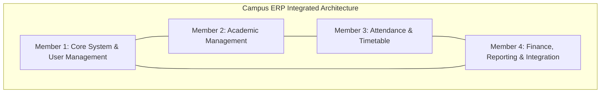

# CAMPUS ERP — TEAM RESPONSIBILITY STRUCTURE
**Project:** Campus ERP — College Management System  
**Organization:** Four-Member Undergraduate Software Engineering Team  
**Architecture:** Integrated Codebase (Model → DAO → Service → SwingWorker → Swing UI)  

---

## 1. Overview & Team Structure

Campus ERP is maintained and developed as a collaborative, four-member collegiate software engineering project. Rather than dividing the codebase into fragmented or isolated branches, all team members contribute to a unified, standard Maven repository adhering to shared design standards, strict coding conventions, and automated JUnit regression testing.

---

## 2. Module Ownership & Member Responsibilities

### Member 1 — Core System and User Management
**Assigned Student:** Member 1 — [Name]  
**Primary Modules:** `com.college.config`, `com.college.util`, `com.college.service.AuthService`, `com.college.service.StudentService`, `com.college.service.FacultyService`, `com.college.ui.LoginFrame`, `com.college.ui.panel.UserManagementPanel`

#### Assigned Responsibilities:
- **Application Architecture & Lifecycle:** Initial startup pipeline (`App.java`), database discovery, and classpath resource loading.
- **Authentication & Authorization:** Secure session creation, role-based access control (`Role.ADMIN`, `Role.FACULTY`, `Role.STUDENT`), and logout auditing.
- **Login & Password Management:** BCrypt salt-and-hash encryption, first-time login mandatory password reset enforcement (`must_change_password`), and password complexity validation (`ValidationUtil`).
- **User & Role Directory:** Administrator user directory panel, account deactivation/reactivation toggling, and username format generation.
- **Student & Faculty Credential Provisioning:** Automated username generation (`STU{YEAR}{SEQ}`, `FAC{DEPT}{SEQ}`), secure temporary password generation, and profile management.
- **Status:** **IMPLEMENTED**

---

### Member 2 — Academic Management
**Assigned Student:** Member 2 — [Name]  
**Primary Modules:** `com.college.service.DepartmentService`, `com.college.service.AcademicProgramService`, `com.college.service.ProgrammeCurriculumService`, `com.college.service.CourseService`, `com.college.service.EnrollmentService`, `com.college.ui.panel.DepartmentPanel`, `com.college.ui.panel.AcademicProgramPanel`, `com.college.ui.panel.ProgrammeCurriculumPanel`, `com.college.ui.panel.CoursePanel`, `com.college.ui.panel.EnrollmentPanel`

#### Assigned Responsibilities:
- **Department Management:** Department catalog, School/Faculty groupings, Head of Department (HOD) metadata, and deactivation protection against active course dependencies.
- **Academic Programmes & Degree Structures:** Degree program definition, qualification levels (`UNDERGRADUATE`, `POSTGRADUATE`, `RESEARCH`, `DIPLOMA`), duration-to-semester calculator, and research milestone structures.
- **Course Catalog & Prerequisites:** Course creation, credit allocation, semester scheduling, and graph-based cycle detection rejecting circular prerequisites ($A \to B \to A$).
- **Curriculum Management:** Course-to-semester mapping with category tags (`CORE`, `ELECTIVE`, `OPEN_ELECTIVE`, `LABORATORY`, `PROJECT`, `RESEARCH`) under regulatory schemes (`R2026`).
- **Student Course Enrollment:** Course registration workflows, capacity limit enforcement, and academic roster tracking.
- **Status:** **IMPLEMENTED**

---

### Member 3 — Attendance and Timetable
**Assigned Student:** Member 3 — [Name]  
**Primary Modules:** `com.college.service.AttendanceSessionService`, `com.college.service.AttendanceService`, `com.college.service.TimetableService`, `com.college.ui.panel.AttendancePanel`, `com.college.ui.panel.TimetablePanel`, `com.college.ui.dialog.StudentCheckInDialog`, `com.college.ui.dialog.ReviewAttendanceDialog`

#### Assigned Responsibilities:
- **Attendance Session Management:** Timed check-in session creation, secure 6-digit numeric OTP generation, countdown timer tracking, and expiration enforcement.
- **Student Attendance Check-In:** Student self-service check-in dialog, anti-tampering lockouts (max 5 failed attempts per session), and enrollment validation.
- **Faculty Review & Finalization:** Live check-in review dialog, manual roster override toggling, and final session closure (`FINALIZED`).
- **Attendance History & Analytics:** Historical attendance lookup, attendance percentage calculations, and low-attendance alert badges ($< 75\%$).
- **Timetable Scheduling:** Weekly schedule matrix, room allocation, time slot conflict prevention, and faculty schedule inspection.
- **Status:** **IMPLEMENTED**

---

### Member 4 — Finance, Reporting and Integration
**Assigned Student:** Member 4 — [Name]  
**Primary Modules:** `com.college.service.FeePaymentService`, `com.college.service.BankDetailsService`, `com.college.service.PaymentGatewayService`, `com.college.service.ReportService`, `com.college.service.AcademicReportService`, `com.college.ui.panel.FeeStructurePanel`, `com.college.ui.panel.FeePaymentPanel`, `com.college.ui.panel.ReportPanel`, `com.college.ui.panel.AcademicOverviewPanel`, `com.college.ui.MainFrame`

#### Assigned Responsibilities:
- **Fee Structure Management:** Semester-wise fee structure definition, fee component breakdowns, and academic year assignments.
- **Fee Payment & Receipts:** Payment recording, automatic sequential receipt generation (`REC-{YEAR}-{SEQ}`), and dual-entry refund recording.
- **Bank Transfer & Payment Simulation:** Institutional bank details configuration, UTR (Unique Transaction Reference) recording with manual clerk verification, and mock payment gateway integration.
- **Reporting & Data Export:** System-wide analytical reports, student roster exports, and syllabus CSV downloads.
- **Application Integration:** Navigation shell (`MainFrame.java`), vector iconography (`CampusIcons.java`), FlatLaf design integration, and cross-module end-to-end integration testing.
- **Status:** **IMPLEMENTED**

---

## 3. Shared Engineering Responsibilities

All four team members share responsibility for cross-cutting engineering activities:

| Activity | Description | Participating Members |
|:---|:---|:---:|
| **Requirements & Domain Analysis** | Reviewing academic ERP specifications and institutional regulatory policies. | All Members (1, 2, 3, 4) |
| **Database Schema Reviews** | Validating DDL migrations, relational integrity constraints, and foreign key cascades. | All Members (1, 2, 3, 4) |
| **Cross-Module Integration** | Ensuring seamless data flow across user creation, course enrollment, attendance, and fees. | All Members (1, 2, 3, 4) |
| **Automated Testing & Bug Fixing** | Writing and maintaining JUnit 5 tests, ensuring 100% regression suite pass rates. | All Members (1, 2, 3, 4) |
| **Application Demonstrations** | Conducting interactive presentation walkthroughs and manual GUI acceptance tests. | All Members (1, 2, 3, 4) |
| **Technical Documentation** | Authoring and reviewing architectural, user, developer, and database manuals. | All Members (1, 2, 3, 4) |

