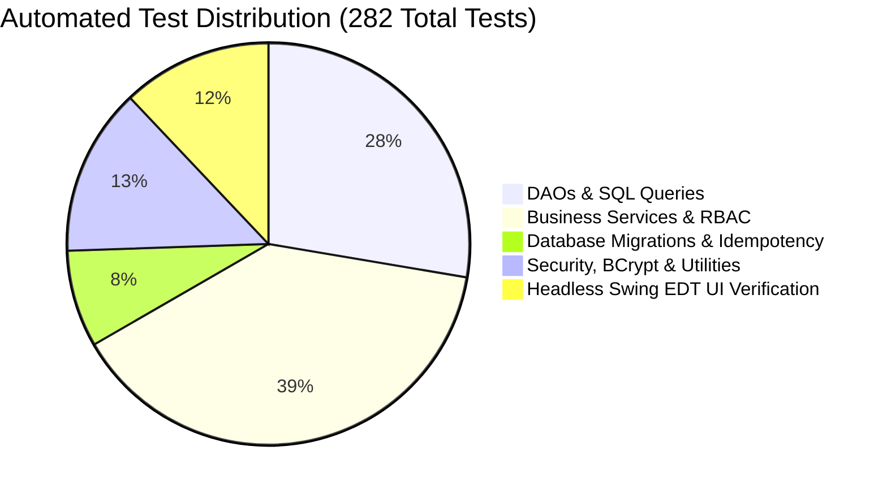

# CAMPUS ERP — TESTING MANUAL & QUALITY ASSURANCE
**Framework:** JUnit 5 (Jupiter 5.10.2) + Surefire 3.2.5  
**Execution Target:** Offline Disposable SQLite DBs (`target/test-dbs/`)  
**Overall Regression Pass Rate:** 282 / 282 Passing Tests (100%)  

---

## 1. Test Architecture & Quality Philosophy

Campus ERP adopts an automated testing approach structured around isolated test fixtures:
- **No Production Database Impact:** All tests run exclusively against in-memory or ephemeral file databases in `target/test-dbs/`. The production database `data/college.db` is strictly isolated.
- **Topological Cleanup:** Test fixtures employ `TestDBHelper.cleanAllTables()` which purges relational records in strict reverse foreign key order (`PRAGMA foreign_keys = ON`).
- **Headless Swing EDT Verification:** GUI components are verified on the Swing Event Dispatch Thread (`SwingUtilities.invokeAndWait`) under headless mode (`java.awt.headless=true`).

---

## 2. Test Execution Instructions

### 2.1 Running the Entire Test Suite
Execute the full regression suite across all 52 test classes:
```bash
mvn test
```

### 2.2 Running Specific Test Suites
Run individual milestone or module test suites using Surefire filters:

```bash
# 1. Academic Structure & Milestone 4 tests
mvn test -Dtest=AcademicStructureMilestone4Test

# 2. Database Migration V9 tests
mvn test -Dtest=DatabaseMigrationMilestone4Test

# 3. Headless Swing EDT GUI verification tests
mvn test -Dtest=Milestone4GuiComponentVerificationTest

# 4. Attendance automation tests
mvn test -Dtest=AttendanceAutomationMilestone3Test

# 5. User management & credential security tests
mvn test -Dtest=UserManagementMilestone2Test
```

---

## 3. Important Test Categories & Coverage



### 3.1 Data Access Object (DAO) Tests (`com.college.dao.*`)
- **Coverage:** Tests parameterized query execution, relational mapping, unique constraint violations, and transaction rollbacks.
- **Key Suites:** `UserDAOTest`, `StudentDAOTest`, `FacultyDAOTest`, `DepartmentDAOTest`, `CourseDAOTest`, `FeePaymentDAOTest`, `AttendanceDAOTest`.

### 3.2 Service Layer & RBAC Tests (`com.college.service.*`)
- **Coverage:** Verifies domain rules, input validation, role-based authorization (e.g. non-admin users cannot alter academic structures or promote students), and business calculations.
- **Key Suites:** `AuthServiceTest`, `StudentServiceTest`, `AcademicStructureMilestone4Test` (includes student-cohort programme consistency, repeat semester graduation adjustments, progression history immutability triggers, and duplicate event prevention), `AttendanceSessionServiceTest`, `FeePaymentServiceTest`, `StudentProgressionServiceTest`.

### 3.3 Database Migration & Idempotency Tests (`com.college.config.*`)
- **Coverage:** Verifies fresh database bootstrapping, incremental additive migrations from earlier schema baselines (V1 through V10), column preservation, trigger installation, historical data normalization, and idempotency across repeated executions.
- **Key Suites:** `DatabaseMigrationMilestone1Test`, `DatabaseMigrationMilestone4Test`, `ExistingDbMigrationTest`.

### 3.4 Headless Swing EDT Component Tests (`com.college.ui.*`)
- **Coverage:** Verifies Swing layout hierarchy, button texts, table columns, filter dropdowns, and modal dialog behavior on the EDT.
- **Key Suites:** `Milestone1GuiComponentVerificationTest`, `Milestone2GuiComponentVerificationTest`, `Milestone3GuiComponentVerificationTest`, `Milestone4GuiComponentVerificationTest`, `DirectoryResponsiveUITest`.

---

## 4. Known Limitations & Acceptance Boundary

> [!IMPORTANT]
> **ACCEPTANCE VERDICT: PASS WITH LIMITATIONS**  
> All automated tests pass with 100% reliability in continuous integration environments. However, the following limitations must be noted for physical desktop evaluations:
> 1. **Physical Desktop GUI Acceptance:** Automated tests verify Event Dispatch Thread (EDT) component instantiation, button existence, and layout binding. Physical user interactions (mouse clicks, focus navigation, high-DPI monitor scaling, and OS-specific window framing) must be validated by a human operator using the manual checklist.
> 2. **Multi-Device Concurrency:** The system uses SQLite embedded storage. Concurrency is limited to the local desktop process. Multi-user concurrent networked access across separate workstations is deferred until the semester break.
> 3. **Payment Processing:** Payment gateway interactions (Razorpay/Mock) are simulated for offline institutional evaluation; real banking API webhooks require online server infrastructure.

---

## 5. Physical Desktop Acceptance Test Checklist

Before final institutional sign-off, a physical desktop verification must be executed using this 10-point checklist. Test credentials must be provisioned securely on first launch (no hardcoded passwords):

| Step | Action | Expected Physical Result | Status |
|:---|:---|:---|:---|
| 1 | Launch `App.main([])` or `run-campus-erp.bat` | Login window displays FlatLaf light theme centered on display | [ ] Pending physical run |
| 2 | Provision initial administrator via `FirstRunAdminSetupDialog` (or `--setup-admin`) and sign in | Admin dashboard opens showing institutional KPI metric cards and navigation sidebar | [ ] Pending physical run |
| 3 | Navigate to Academic Structure panel | School accordion displays 6 institutional schools (Engineering, Computer Applications, Management & Commerce, Arts & Humanities, Hospitality, Health Sciences) | [ ] Pending physical run |
| 4 | Add new degree programme under Department | Modal dialogue opens, auto-calculates total semesters, and updates table upon submit | [ ] Pending physical run |
| 5 | Navigate to User Management & Student Directory | Generate random temporary password for test student/faculty via "Reset Password" | [ ] Pending physical run |
| 6 | Perform student semester progression | Dialog allows Promote/Hold/Repeat; repeated semester increments graduation year | [ ] Pending physical run |
| 7 | Authenticate as provisioned faculty member | Prompts for mandatory first-time password update; dashboard displays assigned courses and schedule | [ ] Pending physical run |
| 8 | Launch 60-second attendance session | Numeric 6-digit OTP displays with active countdown progress bar | [ ] Pending physical run |
| 9 | Authenticate as provisioned student | Prompts for mandatory first-time password update; dashboard displays semester progress and check-in button | [ ] Pending physical run |
| 10 | Submit attendance code & check fee ledger | Check-in marks status PRESENT; 5 failed attempts locks session; fee payments display downloadable receipts | [ ] Pending physical run |


