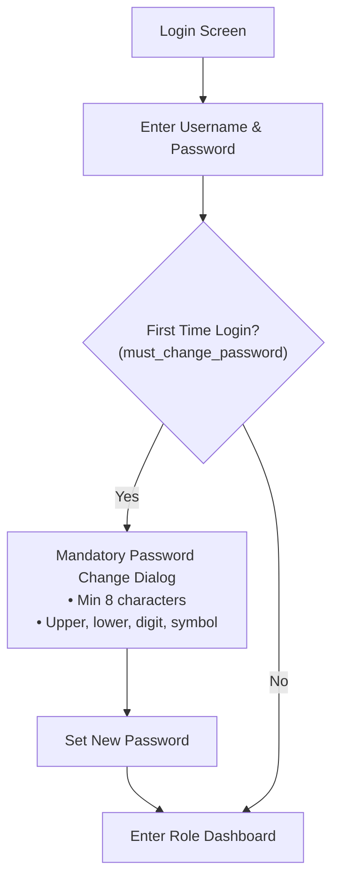

# CAMPUS ERP — USER & OPERATIONAL MANUAL
**System:** Campus ERP — College Management System  
**Version:** 2.3.0  
**Target Audience:** System Administrators, Academic Registrars, Faculty Members, Students  

---

## 1. Authentication & Login Workflows

### 1.1 Application Launch & Login Screen
1. Launch Campus ERP using `scripts/run-campus-erp.bat` or the packaged JAR.
2. The login window displays the institutional monogram, brand headers, and secure credential fields.
3. Enter your **Username** and **Password**.
4. Click **Sign In**.

### 1.2 First-Time Login Password Reset
If logging in with an initial temporary password (or if an administrator reset your credentials):
1. A modal dialog automatically prompts you to change your temporary password.
2. Enter your **New Password** and confirm it in the **Confirm Password** field.
3. The password must contain at least 8 characters, including uppercase, lowercase, numbers, and special symbols.
4. Click **Update Password** to access your dashboard.

---

## 2. Administrator Workflows

Administrators (`ADMIN`) have full access to institutional master data, academic structures, user directories, and finance controls.

### 2.1 User Directory & Account Provisioning
1. Navigate to **Administration** → **User Management**.
2. **Search & Filter:** Search by username, full name, or filter by role (`ADMIN`, `FACULTY`, `STUDENT`) and status (`ACTIVE`, `INACTIVE`).
3. **Reset Password:** Select any user row and click **Reset Password** to generate a compliant temporary password and flag the account for mandatory reset.
4. **Deactivate / Reactivate User:** Select a user and toggle **Deactivate User** to immediately block login access.

### 2.2 Department & School Administration
1. Navigate to **Academics** → **Departments**.
2. **Create Department:** In the left form, enter the unique alphanumeric **Code** (e.g., `MECH`), **Department Name**, select governing **School** (e.g. *School of Engineering*), and enter optional HOD/contact information. Click **Create Department**.
3. **Deactivate Protection:** A department with active courses or student enrollments cannot be deleted or deactivated until dependencies are cleared.

### 2.3 Academic Programmes & Curriculum Management
1. Navigate to **Academics** → **Programmes**.
2. Click **Add Programme** in the footer bar.
3. Enter Programme Code, Name, Short Degree (`B.Tech`, `M.Sc`), Level (`UNDERGRADUATE`, `POSTGRADUATE`, `RESEARCH`, `DIPLOMA`), and duration in years.
4. The system automatically computes total semesters and previews the term layout. For research programmes, check **Research Milestones** to auto-structure coursework and thesis phases.
5. Click **Save Programme**.
6. **Curriculum Mapping:** In **Academics** → **Curriculum**, select the programme, semester, and regulation scheme (`R2026`). Click **Assign Course to Curriculum** to map subjects with categories (`CORE`, `ELECTIVE`, `LABORATORY`, etc.) and enforce prerequisite rules.

### 2.4 Student Cohorts & Semester Progression
1. Navigate to **Academics** → **Cohorts & Progression**.
2. **Create Cohort:** Click **Create New Cohort**, select the Academic Programme and Admission Year. The system auto-calculates the Expected Graduation Year and assigns the canonical cohort code (e.g. `BTECH-AI-2026`).
3. **Promote Students:** Select a cohort to view the student roster. Select a student and click **Promote to Next Semester**. Enter the current academic year and mandatory academic justification (e.g., *Cleared all core exams*). The student advances from semester $N \to N+1$.
4. **Hold or Repeat:** Use **Hold Promotion** for pending clearance or **Repeat Semester** (which automatically adjusts graduation year $+1$).
5. **Audit Trail:** Click **View Progression Audit** on any student to inspect the complete history of progression actions.

---

## 3. Student Workflows

Students (`STUDENT`) access personalized academic schedules, course registrations, attendance logs, and fee receipts.

### 3.1 Student Dashboard
- Upon login, the welcome banner displays your student registration ID, degree programme title, governing school, current semester, and assigned cohort.
- Metric cards display your current semester courses, aggregate attendance percentage, and overall fee balance.

### 3.2 Submitting Attendance Check-In (OTP)
1. When your instructor announces an active attendance session, navigate to **Academics** → **Attendance**.
2. Click **Select Active Session** to choose the open lecture.
3. Enter the 6-digit numeric OTP code displayed on the classroom screen.
4. Click **Submit Check-In**.
5. Your attendance is immediately recorded as `PRESENT`. Note: Entering an invalid code 5 consecutive times triggers a security lockout for that specific course session (leaving your student account and other sessions fully accessible).

### 3.3 Course Enrollment & Schedule Inspection
1. Navigate to **Academics** → **Enrollment** to inspect your active registered courses.
2. Navigate to **Schedule** → **Timetable** to view your weekly lecture schedule by day, classroom, and faculty instructor.

### 3.4 Fee Payments & Receipt Downloads
1. Navigate to **Finance** → **Fee Payments**.
2. View pending fee schedules and payment history.
3. Select any payment and click **Print Receipt** to generate or export an official receipt (`REC-{YEAR}-{SEQ}`).

---

## 4. Faculty Workflows

Faculty members (`FACULTY`) manage course rosters, conduct attendance sessions, input marks, and view teaching schedules.

### 4.1 Faculty Dashboard
- Displays appointed school, department, academic specialization, and count of active teaching courses.

### 4.2 Conducting a Timed Attendance Session
1. Navigate to **Academics** → **Attendance** → **Mark Attendance** tab.
2. Select your Course and Semester, then click **Load Roster**.
3. Click **Open Timed Check-In**.
4. Set the session duration (e.g., 5 or 10 minutes) and enter optional lecture notes.
5. Click **Start Session**.
6. A large modal displays the generated **6-Digit Session Code** and a live countdown timer. Share the code with students in the classroom.
7. Click **Review Check-Ins** to watch the roster update in real time as students submit their check-ins.
8. Manually toggle any student's status if they were excused or late, then click **Finalize Attendance** to lock the session.

### 4.3 Student Marks & Evaluations
1. Navigate to **Academics** → **Examinations** / **Marks**.
2. Select course and examination type (Midterm, Final, Lab).
3. Enter marks out of maximum points and click **Save Marks**.

---

## 5. Reports & Analytical Exports

1. Navigate to **Reports** → **Academic Reports**.
2. Select report type:
   - **Student Attendance Roster:** Displays attendance percentage per course with amber badges for students below the institutional $75\%$ attendance threshold.
   - **Departmental Course Breakdown:** Tabulates faculty teaching loads and course enrollment quotas.
   - **Fee Collection Summary:** Summarizes total collected fees, pending balances, and payment methods.
3. Click **Export to CSV** to save the formatted report to your local disk for spreadsheet analysis.

